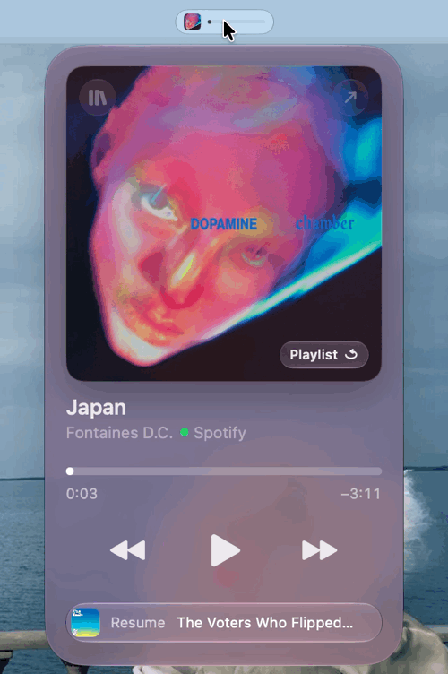
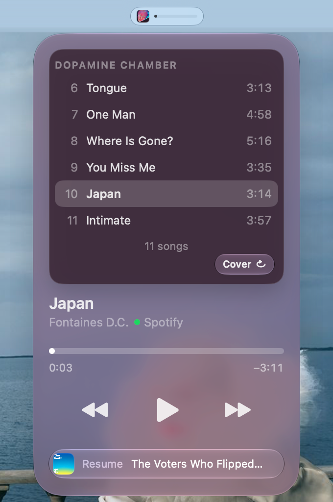
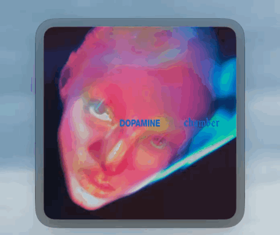

# sideB

The other side of what you're listening to. sideB is a listening companion for the Mac menu bar: a podcast player
of its own and a remote for Apple Music and Spotify, built round the cover, which turns over to show what's on it.



**Free and open source, for macOS 26 or later.** [Download the latest release](https://github.com/orwellhemingway98/sideB/releases/latest).

| The panel | The back of the cover | The mini player |
| --- | --- | --- |
|  |  |  |

## What it does

- **The panel:** click the strip in the menu bar for the big cover, the title, a progress line and the playback buttons.
  The glass takes its colour from the cover.
- **The back of the cover:** click the cover and it turns over to the album, the playlist or the show's episodes.
  Click a row to play it.
- **The mini player:** press Pop out in the cover's corner to float just the cover over your work. Move the pointer
  over it for the controls, click to turn it over, drag to move it.
- **Scrubbing:** drag the line, or scroll over it, with haptic ticks on a Force Touch trackpad and a firmer one at
  chapters. Hold ⌥ while scrolling to set the volume.
- **Podcasts:** follow shows by searching Apple's podcast directory, pasting a feed or importing OPML. Chapters, speed,
  Up Next, downloads for offline listening, and it keeps your place.
- **Music:** whichever you started last is in control. Starting music pauses your podcast and keeps its place.

Keys while the panel is open: Space plays or pauses, ← and → go back and forward, Return turns the cover, ↑ and ↓ move
through the list on the back, ⌘L opens the Library, Esc turns the cover back and then closes the panel.

## Download

Get the **sideB** zip from the [latest release](https://github.com/orwellhemingway98/sideB/releases/latest), unzip it
and move **sideB.app** to Applications. It needs macOS 26 or later.

sideB isn't notarized by Apple (that needs a paid developer account), so macOS blocks it the first time. Open it once,
then go to **System Settings › Privacy & Security** and click **Open Anyway**. After that it opens normally. Because it
isn't notarized, a new version may ask again for the permissions below.

## Permissions

- **Controlling Music and Spotify:** macOS asks the first time sideB sees either running. Choose **Allow**; you can change
  it later in System Settings › Privacy & Security › Automation. sideB never launches an app that isn't running.
- **A playlist in Apple Music:** to play an album from a chosen song, sideB keeps one playlist of its own called
  "sideB" in your library, and refills it each time. You can delete it; sideB makes a new one when it needs to.

## Spotify

Play, pause, skip and scrubbing work with no sign-in. On a Spotify song, the back of the cover shows the song's details.

Listing Spotify albums and your own playlists is optional, because Spotify limits apps like this one. It takes Spotify
Premium and a free developer app of your own: create one at
[developer.spotify.com/dashboard](https://developer.spotify.com/dashboard) with the redirect URI `sideb://callback`, then
choose **Set Up Album Lists…** on the back of the cover and paste its Client ID.

Once you're signed in, clicking a row changes the song and leaves Spotify's window where it is. Without a sign-in, or if
Spotify refuses the request (no active device, say), the click goes through the Spotify app instead and its window comes
forward. If you signed in before version 0.16.4, sign out and back in to give sideB the permission this needs.

## Privacy

There are no analytics and no account. sideB only talks to your podcast feeds and the hosts of their audio and artwork,
Apple's podcast directory when you search it, and Spotify if you set up album lists. Your Spotify sign-in stays in your
Keychain.

## Build

Needs macOS 26, Xcode 26 and [XcodeGen](https://github.com/yonaskolb/XcodeGen).

```sh
brew install xcodegen
xcodegen generate
open SideB.xcodeproj    # then Product › Run (⌘R)
```

Run the tests with `./scripts/test.sh`. `./scripts/release.sh` builds the downloadable zip into `releases/`.

sideB is not affiliated with Apple or Spotify.

## Licence

MIT. See [LICENSE](LICENSE).
